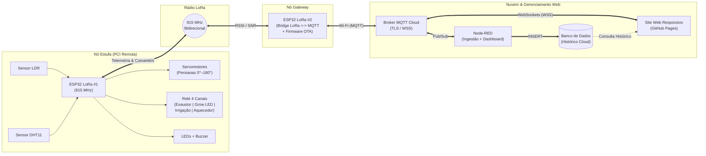

# SmartGreenhouse LoRa — Sistema IoT de Monitoramento e Automação de Estufa Remota


Sistema completo de **Internet das Coisas (IoT)** para monitoramento microclimático e controle automatizado de uma **estufa agrícola remota** sem cobertura Wi-Fi local. O projeto utiliza dois microcontroladores **ESP32 LoRa (915 MHz)** operando em arquitetura *Nó Sensor/Atuador $\leftrightarrow$ Gateway*, integrados a um broker **MQTT**, fluxos de automação em **Node-RED**, persistência histórica em **Banco de Dados em Nuvem** e uma **Aplicação Web de Gerenciamento Remoto**.

> **Universidade Federal de São Paulo (UNIFESP)** — Instituto de Ciência e Tecnologia (ICT - SJC)  
> **Disciplina:** Internet das Coisas (IdC) — Prof. Dr. Gabriel de Freitas Fernandes

---

## Sumário

1. [Visão Geral do Sistema](#visão-geral-do-sistema)
2. [Arquitetura de Comunicação](#arquitetura-de-comunicação)
3. [Funcionalidades e Modos de Operação](#funcionalidades-e-modos-de-operação)
   - [1. Modo Automático (Controle Local Resiliente)](#1-modo-automático-controle-local-resiliente)
   - [2. Modo Manual (Override Remoto pelo Site / Node-RED)](#2-modo-manual-override-remoto-pelo-site--node-red)
4. [Hardware e Pinagem (Nó Estufa — PCI)](#hardware-e-pinagem-nó-estufa--pci)
5. [Protocolo de Mensagens (LoRa & MQTT)](#protocolo-de-mensagens-lora--mqtt)
   - [Pacotes LoRa (915 MHz)](#pacotes-lora-915-mhz)
   - [Tópicos MQTT](#tópicos-mqtt)
6. [Estrutura do Repositório](#estrutura-do-repositório)
7. [Fluxo de Trabalho Git e Automação de Pull Requests](#fluxo-de-trabalho-git-e-automação-de-pull-requests)
8. [Como Executar o Projeto](#como-executar-o-projeto)
9. [Integrantes e Divisão de Responsabilidades](#integrantes-e-divisão-de-responsabilidades)

---

## Visão Geral do Sistema

Estufas de cultivo geralmente estão afastadas dos pontos de acesso de internet. Para contornar essa limitação, o **SmartGreenhouse LoRa** divide a solução em três camadas:

1. **Nó Estufa (ESP32 LoRa #1 — Remoto):** Instalado na estufa em uma **Placa de Circuito Impresso (PCI)** dedicada. Realiza a leitura de **luminosidade (LDR)**, **temperatura e umidade do ar (DHT11)**, controla a abertura gradual das **persianas via servomotores**, aciona **4 cargas de potência via Módulo Relé** (Exaustor, Iluminação *Grow LED*, Irrigação/Nebulização e Aquecedor) e emite alertas locais (**LEDs de status e Buzzer**). Possui modo de operação autônomo (*fail-safe* local) caso o link de rádio caia.
2. **Nó Gateway (ESP32 LoRa #2 — Central):** Localizado em área com recepção Wi-Fi. Recebe os pacotes LoRa em 915 MHz do Nó Estufa, anexa indicadores de qualidade de enlace (`RSSI` e `SNR`) e publica os dados via **MQTT** na nuvem, além de retransmitir comandos vindos da web para a estufa. Conta com suporte a **atualização remota de firmware (OTA)**.
3. **Nuvem, Banco de Dados e Site Web:**
   * **Node-RED:** Orquestra a ingestão dos pacotes MQTT, aplica regras de negócio/alertas, persiste os registros no banco de dados e disponibiliza o painel de controle `/ui`.
   * **Banco de Dados Histórico (Supabase / PostgreSQL):** Armazena a série temporal completa de sensores e estado dos atuadores.
   * **Site Web de Controle (`web/`):** Interface web responsiva hospedada neste próprio repositório via **GitHub Pages**, conectada em tempo real via **MQTT over WebSockets (WSS)** e integrada à API do banco para visualização de gráficos históricos.

---

## Arquitetura de Comunicação



---

## Funcionalidades e Modos de Operação

### 1. Modo Automático (Controle Local Resiliente)
O Nó Estufa ajusta continuamente o microclima com base nos limiares configurados:
* **Controle Gradual das Persianas (Servomotores):**
  * **Sombreamento Térmico ($30^\circ$):** Acionado quando a luminosidade é muito alta (`> 80%`) acompanhada de elevação de temperatura (`> 28 °C`), reduzindo a insolação direta.
  * **Abertura Plena ($90^\circ$):** Acionada em condições normais de luz diurna (`30% a 80%`) para maximizar a iluminação natural e a renovação de ar.
  * **Isolamento Noturno ($0^\circ$):** Fecha totalmente as persianas à noite ou sob baixíssima temperatura (`< 18 °C`) para conservar calor.
* **Acionamento do Módulo Relé de 4 Canais:**
  * **Canal 1 — Exaustor/Ventilador:** Liga automaticamente quando `Temperatura > 28 °C` ou `Umidade > 80%`.
  * **Canal 2 — Iluminação Artificial (Grow LED):** Liga quando `Luminosidade < 30%` durante o fotoperíodo diurno.
  * **Canal 3 — Nebulização / Irrigação:** Acionado quando `Umidade < 45%`.
  * **Canal 4 — Aquecedor:** Acionado quando `Temperatura < 15 °C`.
* **Alarme Audiovisual Local (LEDs + Buzzer):**
  * Sinalização por LEDs de estado (Normal, Manual, Crítico) e acionamento sonoro do **Buzzer** em situações de temperatura crítica (`>= 35 °C`) ou movimentação das persianas.

### 2. Modo Manual (Override Remoto pelo Site / Node-RED)
Através do painel web, o operador pode assumir o controle manual a qualquer momento:
* Ajuste fino do ângulo de abertura das persianas ($0^\circ$ a $180^\circ$) por *slider* ou botões de atalho (*Fechada*, *Meia-Luz*, *Aberta*).
* Acionamento individual em tempo real de cada um dos 4 canais do relé.
* Silenciamento remoto (*Mute*) ou teste de sirene do Buzzer.
* Atualização remota dos *setpoints* de temperatura, umidade e luminosidade do modo automático.

---

## Hardware e Pinagem (Nó Estufa — PCI)

A Placa de Circuito Impresso (PCI) do Nó Estufa respeita os pinos dedicados ao transceptor SPI LoRa SX1276 (`GPIO 5, 14, 18, 19, 23, 26`) e inclui desacoplamento capacitivo ($100\,\mu\text{F}$) no barramento de $5\text{V}$ dos servomotores.

| Periférico / Sensor | Pino (ESP32 LoRa) | Tipo de Interface | Função no Sistema |
| :--- | :---: | :---: | :--- |
| **Transceptor LoRa SX1276** | `5, 18, 19, 23, 14, 26` | SPI Interno | Comunicação RF bidirecional em 915 MHz |
| **Sensor LDR** | `GPIO 36 (VP)` | Entrada Analógica (ADC1) | Medição do nível de luminosidade (%) |
| **Sensor DHT11** | `GPIO 13` | Digital One-Wire | Medição de temperatura (°C) e umidade (%) |
| **Servomotor 1 (Persiana Principal)** | `GPIO 12` | Saída PWM (50 Hz) | Controle angular da persiana ($0^\circ - 180^\circ$) |
| **Servomotor 2 (Escotilha Auxiliar)** | `GPIO 25` | Saída PWM (50 Hz) | Controle de ventilação superior |
| **Relé 1 — Exaustor** | `GPIO 17` | Saída Digital | Ventilação forçada para redução térmica |
| **Relé 2 — Iluminação Grow LED** | `GPIO 2` | Saída Digital | Suplementação luminosa |
| **Relé 3 — Irrigação / Nebulizador** | `GPIO 27` | Saída Digital | Controle de umidade baixa |
| **Relé 4 — Aquecedor** | `GPIO 32` | Saída Digital | Aquecimento em noites frias |
| **Buzzer de Alerta** | `GPIO 33` | Saída Digital / PWM | Alarme sonoro local de emergência |
| **LEDs de Status (Verde / Vermelho)** | `GPIO 21 / GPIO 22` | Saída Digital | Indicação visual de operação e falha |

---

## Protocolo de Mensagens (LoRa & MQTT)

### Pacotes LoRa (915 MHz)
* **Telemetria (Estufa $\rightarrow$ Gateway):**
  ```json
  {"id":"EST01","seq":142,"t":26.4,"h":62.0,"l":78,"srv":90,"r":[0,0,0,0],"al":0,"m":"AUTO"}
  ```
* **Comando de Atuação (Gateway $\rightarrow$ Estufa):**
  ```json
  {"target":"EST01","cmd":"SET","m":"MAN","srv":45,"r":[1,0,0,0],"buz":0}
  ```

### Tópicos MQTT
| Tópico | Direção | Descrição |
| :--- | :---: | :--- |
| `unifesp/iot/estufa/telemetria` | `Gateway -> Nuvem` | JSON com leituras dos sensores, estado dos atuadores e `RSSI`/`SNR` LoRa |
| `unifesp/iot/estufa/comando/modo` | `Nuvem -> Gateway` | Altera modo de operação (`"AUTO"` ou `"MAN"`) |
| `unifesp/iot/estufa/comando/persiana` | `Nuvem -> Gateway` | Define o ângulo da persiana (`0` a `180`) |
| `unifesp/iot/estufa/comando/reles` | `Nuvem -> Gateway` | Aciona canal específico do módulo relé (`{"ch":1,"state":1}`) |
| `unifesp/iot/estufa/comando/config` | `Nuvem -> Gateway` | Atualiza limiares de temperatura, umidade e luz |

---

## Estrutura do Repositório

```text
projeto-IOT/
├── .github/
│   ├── workflows/
│   │   ├── pr-code-review.yml          # CI e Code Review Automatizado nos Pull Requests
│   │   └── enforce-branch-protection.yml
│   └── PULL_REQUEST_TEMPLATE.md
├── .githooks/                          # Hooks Git que bloqueiam commits diretos em main/develop
│   ├── pre-commit
│   └── pre-push
├── firmware/
│   ├── no_estufa_lora/
│   │   └── no_estufa_lora.ino          # Firmware do ESP32 LoRa #1 (Estufa)
│   └── no_gateway_lora_mqtt/
│       └── no_gateway_lora_mqtt.ino    # Firmware do ESP32 LoRa #2 (Gateway + OTA)
├── web/                                # Site de Gerenciamento Remoto (GitHub Pages)
│   ├── index.html
│   ├── css/
│   │   └── styles.css
│   └── js/
│       └── app.js
├── nuvem_nodered/
│   ├── flows_estufa.json               # Fluxos exportados do Node-RED
│   └── schema_banco.sql                # Script SQL da tabela de histórico
├── pci_hardware/
│   ├── README.md
│   └── lista_materiais_BOM.md          # Lista de componentes da PCI
├── encapsulamento_3d/
│   └── README.md                       # Modelos 3D (.STL) do encapsulamento
├── docs/
│   └── evidencias/
│       └── README.md                   # Fotos e vídeos de validação
├── scripts/
│   └── configure-branch-protection.ps1 # Script para ativar hooks e proteção de branch
└── README.md
```

---

## Fluxo de Trabalho Git e Automação de Pull Requests

Este repositório conta com automação de governança (`.githooks/` e **GitHub Actions**) que **bloqueia commits diretos nas branches `main` e `develop`**. Todo desenvolvimento deve seguir o fluxo abaixo:

1. **Ative os hooks locais após clonar (uma única vez):**
   ```powershell
   ./scripts/configure-branch-protection.ps1
   ```
2. **Crie uma branch separada a partir da `develop`:**
   ```bash
   git checkout develop
   git pull origin develop
   git checkout -b feature/minha-funcionalidade
   ```
3. **Faça seus commits e envie sua branch para o GitHub:**
   ```bash
   git add .
   git commit -m "feat: implementa leitura do sensor DHT11 e controle do servo"
   git push -u origin feature/minha-funcionalidade
   ```
4. **Abra um Pull Request para a branch `develop`:**
   * O workflow **`Automated Code Review & Validation`** executará automaticamente a verificação de código e comentará o relatório no PR.
   * **Requisito de Merge:** O PR só poderá ser integrado à `develop` após passar no Code Review automatizado **e** receber a aprovação (**Approve**) de pelo menos **1 outro integrante do grupo**.

---

## Como Executar o Projeto

1. **Firmware dos ESP32 LoRa (`firmware/`):**
   * Instale na Arduino IDE / PlatformIO as bibliotecas `LoRa` (por Sandeep Mistry), `DHT sensor library`, `ESP32Servo`, `PubSubClient` e `ArduinoJson`.
   * Grave `no_estufa_lora.ino` no ESP32 #1 (Estufa) e `no_gateway_lora_mqtt.ino` no ESP32 #2 (Gateway).
2. **Banco de Dados e Node-RED (`nuvem_nodered/`):**
   * Execute o script `schema_banco.sql` na instância PostgreSQL/Supabase (ou SQLite).
   * No Node-RED, importe o arquivo `flows_estufa.json`, configure as credenciais do Broker MQTT e do banco de dados e clique em **Deploy**.
3. **Site de Gerenciamento Remoto (`web/`):**
   * Acesse diretamente pela URL do **GitHub Pages** deste repositório ou abra `web/index.html` no navegador.

---

## Integrantes e Divisão de Responsabilidades

| Frente / Etapa do Projeto | Descrição das Entregas sob Responsabilidade | Nome do(a) Integrante | RA | GitHub |
| :--- | :--- | :---: | :---: | :---: |
| **1. Hardware, Circuito e PCI** | Validação em protoboard, esquemático elétrico, confecção da Placa de Circuito Impresso (PCI) e modelagem do encapsulamento 3D | *[Inserir Nome]* | *[Inserir RA]* | `@usuario` |
| **2. Firmware Nó Estufa & LoRa** | Código do ESP32 LoRa #1 (`no_estufa_lora.ino`), leitura de sensores (DHT11/LDR), controle de Servos/Relés/Buzzer e protocolo LoRa 915 MHz | *[Inserir Nome]* | *[Inserir RA]* | `@usuario` |
| **3. Firmware Nó Gateway & OTA** | Código do ESP32 LoRa #2 (`no_gateway_lora_mqtt.ino`), ponte LoRa $\leftrightarrow$ Wi-Fi/MQTT, leitura de RSSI/SNR e atualização remota (OTA) | *[Inserir Nome]* | *[Inserir RA]* | `@usuario` |
| **4. Nuvem (Node-RED), Banco & Web** | Fluxos do Node-RED (`flows_estufa.json`), banco de dados histórico (`schema_banco.sql`) e site de controle remoto (`web/`) | *[Inserir Nome]* | *[Inserir RA]* | `@usuario` |