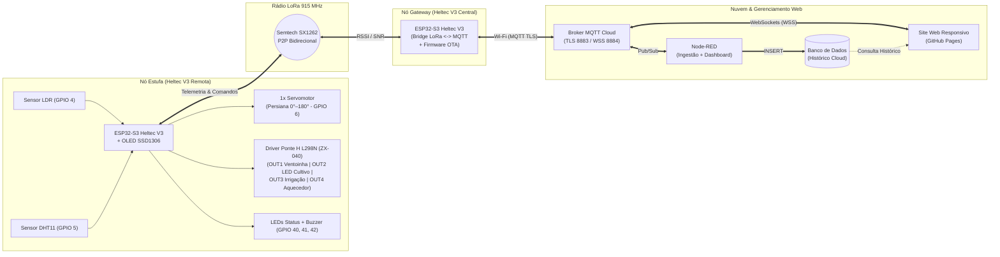

# SmartGreenhouse LoRa — Sistema IoT de Monitoramento e Automação de Estufa Remota

-blue?style=flat-square&logo=espressif)


Sistema completo de **Internet das Coisas (IoT)** para monitoramento microclimático e controle automatizado de uma **estufa agrícola remota** sem cobertura Wi-Fi local. O projeto utiliza dois microcontroladores **ESP32-S3 LoRa 915 MHz (Heltec WiFi LoRa 32 V3)** operando em arquitetura *Nó Sensor/Atuador $\leftrightarrow$ Gateway*, integrados a um broker **MQTT**, fluxos de automação em **Node-RED**, persistência histórica em **Banco de Dados em Nuvem** e uma **Aplicação Web de Gerenciamento Remoto**.

> **Universidade Federal de São Paulo (UNIFESP)** — Instituto de Ciência e Tecnologia (ICT - SJC)  
> **Disciplina:** Internet das Coisas (IdC) — Prof. Dr. Gabriel de Freitas Fernandes

---

## Sumário

1. [Visão Geral do Sistema](#visão-geral-do-sistema)
2. [Arquitetura de Comunicação](#arquitetura-de-comunicação)
3. [Funcionalidades e Modos de Operação](#funcionalidades-e-modos-de-operação)
   - [1. Modo Automático (Controle Local Resiliente)](#1-modo-automático-controle-local-resiliente)
   - [2. Modo Manual (Override Remoto pelo Site / Node-RED)](#2-modo-manual-override-remoto-pelo-site--node-red)
4. [Hardware e Pinagem (Nó Estufa — Heltec V3)](#hardware-e-pinagem-nó-estufa--heltec-v3)
5. [Protocolo de Mensagens (LoRa & MQTT)](#protocolo-de-mensagens-lora--mqtt)
   - [Pacotes LoRa (915 MHz)](#pacotes-lora-915-mhz)
   - [Tópicos MQTT](#tópicos-mqtt)
6. [Estrutura do Repositório](#estrutura-do-repositório)
7. [Fluxo de Trabalho Git e Automação de Pull Requests](#fluxo-de-trabalho-git-e-automação-de-pull-requests)
8. [Como Executar o Projeto](#como-executar-o-projeto)
9. [Integrantes e Divisão de Responsabilidades](#integrantes-e-divisão-de-responsabilidades)

---

## Visão Geral do Sistema

Estufas de cultivo frequentemente estão afastadas de pontos de acesso Wi-Fi. Para contornar essa limitação e garantir alta confiabilidade, o **SmartGreenhouse LoRa** organiza a solução em três camadas:

1. **Nó Estufa (ESP32-S3 Heltec WiFi LoRa 32 V3 — Remoto):** Instalado na estufa em uma placa/circuito dedicado. Realiza a leitura contínua de **luminosidade (LDR)** e **temperatura e umidade do ar (DHT11)**, exibe o diagnóstico no **Display OLED SSD1306 integrado**, controla o ângulo da **persiana via 1 servomotor**, aciona **4 saídas de potência via Ponte H L298N (ZX-040)** (Ventoinha 5V de exaustão, LED de cultivo/iluminação, LED simulador de irrigação e LED simulador de aquecedor) e sinaliza status localmente (**LEDs Verde/Vermelho e Buzzer**). Possui controle autônomo local (*fail-safe*) caso o link de rádio caia.
2. **Nó Gateway (ESP32-S3 Heltec WiFi LoRa 32 V3 — Central):** Localizado na sede com conexão Wi-Fi. Recebe os pacotes LoRa em 915 MHz (via transceptor Semtech SX1262), registra a qualidade de enlace (`RSSI` e `SNR`) e publica os dados via **MQTT** na nuvem, além de retransmitir comandos recebidos da interface web para a estufa. Conta com suporte a **atualização remota de firmware (OTA)**.
3. **Nuvem, Banco de Dados e Site Web:**
   * **Node-RED:** Orquestra a ingestão dos pacotes MQTT, executa regras de negócio e limites de alarme, persiste os registros no banco de dados e disponibiliza o painel de controle `/ui`.
   * **Banco de Dados Histórico (Supabase / PostgreSQL):** Armazena a série temporal completa de leituras dos sensores, posições da persiana e estados das saídas.
   * **Site Web de Controle (`web/`):** Interface web responsiva hospedada diretamente neste repositório via **GitHub Pages**, conectada em tempo real via **MQTT over WebSockets (WSS)** e integrada à API do banco para visualização de gráficos históricos.

---

## Arquitetura de Comunicação



---

## Funcionalidades e Modos de Operação

### 1. Modo Automático (Controle Local Resiliente)
O Nó Estufa avalia continuamente os sensores a cada ciclo curto (~600 ms para LDR e 2 s para DHT11) e atua autonomamente:

* **Controle do Servomotor da Persiana (GPIO 6) em Resposta à Luz (LDR):**
  * **Escuro / Tampando o LDR (`Luz < 25%`):** Persiana fecha em **`0°` (Fechada)** para isolamento térmico e **LIGA o OUT2 (LED de Cultivo)** para suplementação luminosa.
  * **Luz Ambiente Normal (`25% <= Luz <= 75%`):** Persiana abre em **`90°` (Aberta)** para máximo aproveitamento da luz solar e ventilação natural, **DESLIGANDO o OUT2**.
  * **Sol Muito Forte / Lanterna no LDR (`Luz > 75%`):** Persiana inclina para **`160°` (Sombreamento)** para proteger as plantas contra insolação excessiva e queima de folhas.
* **Controle das Saídas da Ponte H L298N (ZX-040):**
  * **OUT1 — Ventoinha 5V (Exaustor / Refrigeração):** Liga quando `Temperatura > 28 °C` ou `Umidade > 80%`.
  * **OUT2 — LED de Cultivo (Iluminação Suplementar):** Liga automaticamente quando `Luz < 25%`.
  * **OUT3 — Irrigação / Nebulização (LED Simulador Azul):** Liga quando `Umidade < 45%`.
  * **OUT4 — Aquecedor Térmico (LED Simulador Vermelho):** Liga quando `Temperatura < 18 °C`.
* **Alarme Audiovisual Local (Buzzer + LEDs):**
  * **LED Verde (GPIO 41):** Aceso contínuo durante operação normal.
  * **LED Vermelho (GPIO 40) + Buzzer (GPIO 42):** Acionados em caso de emergência climática (`Temperatura >= 35 °C`), forçando a Ventoinha (OUT1) a ligar e transmitindo status de alerta via LoRa/MQTT.
  * O Buzzer também emite bipes curtos de aviso ao movimentar a persiana.

### 2. Modo Manual (Override Remoto pelo Site / Node-RED)
Através do painel web ou do Node-RED, o operador pode assumir o controle a qualquer momento:
* Ajuste do ângulo da persiana ($0^\circ$ a $180^\circ$) por *slider* ou atalhos rápidos (*Fechar 0°*, *Meia-Luz 45°*, *Abrir 90°*, *Sombra 160°*).
* Acionamento manual e individual das 4 saídas do L298N (Ventoinha, LED Cultivo, Irrigação, Aquecedor).
* Silenciamento temporário (*Mute*) ou teste manual do Buzzer.
* Reprogramação remota dos limiares de acionamento do modo automático.

---

## Hardware e Pinagem (Nó Estufa — Heltec V3)

O circuito do Nó Estufa foi dimensionado para a placa **Heltec WiFi LoRa 32 V3 (ESP32-S3)** com transceptor **Semtech SX1262 (915 MHz)** e **Display OLED SSD1306 integrado**.

| Periférico / Sensor | Pino na Heltec V3 | Tipo de Interface | Função no Sistema |
| :--- | :---: | :---: | :--- |
| **LoRa Semtech SX1262** | `NSS=8, SCK=9, MOSI=10, MISO=11, RST=12, BUSY=13, DIO1=14` | SPI Dedicado | Comunicação rádio LoRa 915 MHz |
| **Display OLED SSD1306 (128x64)** | `SDA=17, SCL=18, RST=21, Vext=36` | I2C Interno | Exibição local de IP, sensores, persiana, saídas e LoRa |
| **LED Onboard Branco** | `GPIO 35` | Saída Digital | Indicação de envio/recepção de pacotes LoRa |
| **Botão PRG / BOOT** | `GPIO 0` | Entrada com Pull-up | Alterna manualmente entre modo AUTO e MANUAL na bancada |
| **Sensor LDR (Luminosidade)** | `GPIO 4` | Entrada Analógica (ADC1) | Divisor de tensão com resistor de $10\text{ k}\Omega$ para medição de luz (%) |
| **Sensor DHT11 (Temp. e Umidade)** | `GPIO 5` | Digital One-Wire | Medição de temperatura (°C) e umidade relativa (%) |
| **Servomotor da Persiana** | `GPIO 6` | Saída PWM (50 Hz) | Controle do ângulo das aletas da persiana ($0^\circ$ a $180^\circ$) |
| **Ponte H L298N — IN1 (OUT1)** | `GPIO 47` | Saída Digital (HIGH=ON) | Aciona a **Ventoinha 5V** (Exaustor) |
| **Ponte H L298N — IN2 (OUT2)** | `GPIO 48` | Saída Digital (HIGH=ON) | Aciona o **LED de Cultivo** (Iluminação) |
| **Ponte H L298N — IN3 (OUT3)** | `GPIO 45` | Saída Digital (HIGH=ON) | Aciona o **LED Simulador de Irrigação** (Azul) |
| **Ponte H L298N — IN4 (OUT4)** | `GPIO 46` | Saída Digital (HIGH=ON) | Aciona o **LED Simulador de Aquecedor** (Vermelho) |
| **Buzzer de Alerta** | `GPIO 42` | Saída Digital | Alarme sonoro local de emergência e movimentação |
| **LED Status Verde** | `GPIO 41` | Saída Digital | Indicação visual de operação normal |
| **LED Status Vermelho** | `GPIO 40` | Saída Digital | Indicação visual de alarme crítico |

> **Nota de Alimentação do L298N (ZX-040):** O módulo Ponte H L298N deve receber `+5V` tanto no borne `12V` (potência das saídas) quanto no borne `+5V` (lógica interna), com o parafuso central `GND` conectado ao terra comum da protoboard/ESP32. Os jumpers `ENA` e `ENB` devem permanecer inseridos.

---

## Protocolo de Mensagens (LoRa & MQTT)

### Pacotes LoRa (915 MHz)
* **Telemetria (Estufa $\rightarrow$ Gateway a cada 5s):**
  ```json
  {"id":"EST01","seq":142,"t":26.4,"h":62.0,"l":78,"srv":90,"r":[0,0,0,0],"al":0,"m":"AUTO"}
  ```
  *(Onde: `t` = Temp °C, `h` = Umidade %, `l` = Luz %, `srv` = Ângulo do servo, `r` = Saídas OUT1..OUT4 do L298N, `al` = Alarme, `m` = Modo).*
* **Comando de Atuação (Gateway $\rightarrow$ Estufa sob demanda):**
  ```json
  {"target":"EST01","cmd":"SET","m":"MAN","srv":45,"r":[1,0,0,0],"buz":0}
  ```
* **Configuração de Limiares (Gateway $\rightarrow$ Estufa):**
  ```json
  {"target":"EST01","cmd":"CFG","tMax":28.0,"tMin":18.0,"hMin":45.0,"lMin":25}
  ```

### Tópicos MQTT
| Tópico | Direção | Descrição |
| :--- | :---: | :--- |
| `unifesp/iot/estufa/telemetria` | `Gateway -> Nuvem` | Payload JSON completo da estufa acrescido de `RSSI` e `SNR` do link LoRa |
| `unifesp/iot/estufa/comando/modo` | `Nuvem -> Gateway` | Define o modo de operação (`"AUTO"` ou `"MAN"`) |
| `unifesp/iot/estufa/comando/persiana` | `Nuvem -> Gateway` | Define o ângulo da persiana (`0` a `180`) |
| `unifesp/iot/estufa/comando/reles` | `Nuvem -> Gateway` | Aciona saída individual da Ponte H L298N (`{"ch":0,"state":1}`) |
| `unifesp/iot/estufa/comando/config` | `Nuvem -> Gateway` | Reconfigura setpoints de automação remotamente |

---

## Estrutura do Repositório

```text
projeto-IOT/
├── .github/
│   ├── workflows/
│   │   ├── pr-code-review.yml          # CI e Code Review Automatizado nos Pull Requests
│   │   └── enforce-branch-protection.yml
│   └── PULL_REQUEST_TEMPLATE.md
├── .githooks/                          # Hooks Git que bloqueiam commits diretos em main/develop
│   ├── pre-commit
│   └── pre-push
├── firmware/
│   ├── no_estufa_lora/
│   │   └── no_estufa_lora.ino          # Firmware do Nó Estufa (Heltec V3 + L298N + Sensores)
│   ├── no_gateway_lora_mqtt/
│   │   └── no_gateway_lora_mqtt.ino    # Firmware do Nó Gateway (Heltec V3 + Wi-Fi/MQTT + OTA)
│   └── teste_hardware_lora_wifi_oled/
│       └── teste_hardware_lora_wifi_oled.ino # Diagnóstico completo de bancada (SX1262 + OLED + AP)
├── web/                                # Site de Gerenciamento Remoto (GitHub Pages)
│   ├── index.html
│   ├── css/
│   │   └── styles.css
│   └── js/
│       └── app.js
├── nuvem_nodered/
│   ├── flows_estufa.json               # Fluxos exportados do Node-RED
│   └── schema_banco.sql                # Script SQL da tabela de histórico
├── pci_hardware/
│   ├── README.md
│   └── lista_materiais_BOM.md          # Lista de componentes da PCI
├── encapsulamento_3d/
│   └── README.md                       # Modelos 3D (.STL) do encapsulamento
├── docs/
│   └── evidencias/
│       └── README.md                   # Fotos e vídeos de validação
├── scripts/
│   └── configure-branch-protection.ps1 # Script para ativar hooks e proteção de branch
└── README.md
```

---

## Fluxo de Trabalho Git e Automação de Pull Requests

Este repositório conta com automação de governança (`.githooks/` e **GitHub Actions**) que **bloqueia commits diretos nas branches `main` e `develop`**. Todo desenvolvimento deve seguir o fluxo abaixo:

1. **Ative os hooks locais após clonar (uma única vez):**
   ```powershell
   ./scripts/configure-branch-protection.ps1
   ```
2. **Crie uma branch separada a partir da `develop`:**
   ```bash
   git checkout develop
   git pull origin develop
   git checkout -b feature/minha-funcionalidade
   ```
3. **Faça seus commits e envie sua branch para o GitHub:**
   ```bash
   git add .
   git commit -m "feat: implementa controle do servo via LDR"
   git push -u origin feature/minha-funcionalidade
   ```
4. **Abra um Pull Request para a branch `develop`:**
   * O workflow **`Automated Code Review & Validation`** executará automaticamente a verificação de código e comentará o relatório no PR.
   * **Requisito de Merge:** O PR só poderá ser integrado à `develop` após passar no Code Review automatizado **e** receber a aprovação (**Approve**) de pelo menos **1 outro integrante do grupo**.

---

## Como Executar o Projeto

1. **Bibliotecas Necessárias (Arduino IDE):**
   * No Gerenciador de Bibliotecas da Arduino IDE, instale:
     * **`RadioLib`** (por Jan Gromes) — suporte ao chip LoRa Semtech SX1262
     * **`Adafruit SSD1306`** e **`Adafruit GFX Library`** — display OLED integrado
     * **`DHT sensor library`** (por Adafruit) e **`Adafruit Unified Sensor`**
     * **`ESP32Servo`** (por Kevin Harrington / John K. Bennett)
     * **`ArduinoJson`** (por Benoit Blanchon)
     * **`PubSubClient`** (por Nick O'Leary)
2. **Gravação do Firmware:**
   * Em **Ferramentas $\rightarrow$ Placa**, selecione **`Heltec WiFi LoRa 32(V3)`** (ou `ESP32S3 Dev Module`).
   * Grave `no_estufa_lora.ino` no ESP32-S3 da Estufa e `no_gateway_lora_mqtt.ino` no ESP32-S3 Gateway.
3. **Painel Web de Validação Local na Bancada:**
   * O Nó Estufa inicia um ponto de acesso Wi-Fi próprio: **`Estufa_LoRa_V3`** (senha: **`12345678`**).
   * Conectando pelo celular ou notebook e acessando **`http://192.168.4.1`**, é possível acionar manualmente o servomotor, as 4 saídas do L298N e visualizar os sensores em tempo real.
4. **Banco de Dados e Node-RED (`nuvem_nodered/`):**
   * Execute o script `schema_banco.sql` na instância PostgreSQL/Supabase (ou SQLite).
   * No Node-RED, importe o arquivo `flows_estufa.json`, configure as credenciais do Broker MQTT e do banco de dados e clique em **Deploy**.
5. **Site de Gerenciamento Remoto (`web/`):**
   * Acesse diretamente pela URL do **GitHub Pages** deste repositório ou abra `web/index.html` no navegador.

---

## Integrantes e Divisão de Responsabilidades

| Frente / Etapa do Projeto | Descrição das Entregas sob Responsabilidade | Nome do(a) Integrante | RA | GitHub |
| :--- | :--- | :---: | :---: | :---: |
| **1. Hardware, Circuito e PCI** | Validação em protoboard, esquemático elétrico, confecção da Placa de Circuito Impresso (PCI) e modelagem do encapsulamento 3D | *[Inserir Nome]* | *[Inserir RA]* | `@usuario` |
| **2. Firmware Nó Estufa & LoRa** | Código do ESP32 LoRa #1 (`no_estufa_lora.ino`), leitura de sensores (DHT11/LDR), controle do Servo/L298N/Buzzer e protocolo LoRa 915 MHz | *[Inserir Nome]* | *[Inserir RA]* | `@usuario` |
| **3. Firmware Nó Gateway & OTA** | Código do ESP32 LoRa #2 (`no_gateway_lora_mqtt.ino`), ponte LoRa $\leftrightarrow$ Wi-Fi/MQTT, leitura de RSSI/SNR e atualização remota (OTA) | *[Inserir Nome]* | *[Inserir RA]* | `@usuario` |
| **4. Nuvem (Node-RED), Banco & Web** | Fluxos do Node-RED (`flows_estufa.json`), banco de dados histórico (`schema_banco.sql`) e site de controle remoto (`web/`) | *[Inserir Nome]* | *[Inserir RA]* | `@usuario` |
